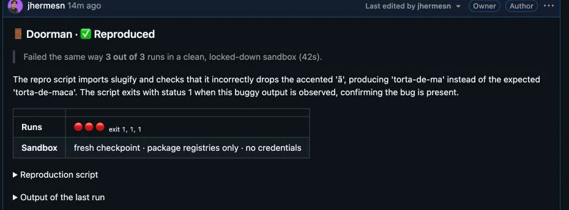
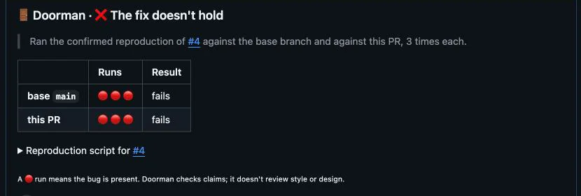
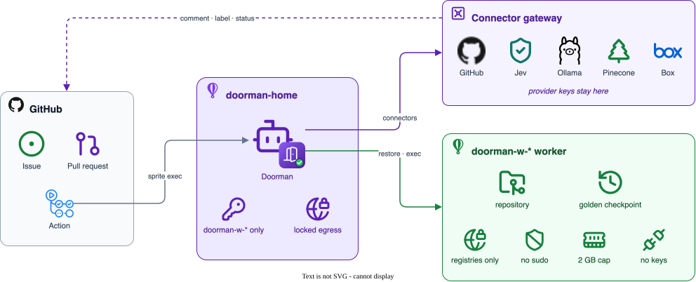

<div align="center">


# Doorman

**No repro, no entry.**

Doorman reproduces every new bug report in a locked-down [Fly.io Sprite](https://fly.io/sprites)<br>and checks that pull requests claiming a fix actually fix it.

[](https://github.com/jhermesn/doorman/actions/workflows/ci.yml)
[](LICENSE)
[](https://fly.io/sprites)

</div>

## What it does

- 🔁 **New issue:** writes a script that shows the bug and runs it 3 times in a clean sandbox, then comments and labels the issue `repro:confirmed`, `repro:needs-info` or `repro:cannot-reproduce`.
- ✅ **PR that says `Fixes #N`:** runs that script on the base branch and on the PR, and sets a `doorman/repro` commit status.
- 🛑 **Hostile report:** reports that try to steer the agent are not run, and every command it proposes is checked before it runs.

<p align="center">
  
</p>

<p align="center">
  
</p>

See it live on the [pie-utils](https://github.com/jhermesn/pie-utils/issues) demo repo.

## How it works

<p align="center">
  
</p>

1. A GitHub Action calls Doorman on its home Sprite.
2. Doorman restores a worker Sprite to a clean checkpoint (about 3 s).
3. A model on Ollama writes and runs the reproduction on the worker; TypeSafe's Jev approves each command first.
4. The script must fail 3 out of 3 times to count. Doorman then posts the result.

The worker can reach package registries only, holds no credentials and can't use sudo. API keys stay in Fly.io's connector gateway. Details: [docs/security.md](docs/security.md).

## Use it

Add this workflow to your repository after [setting up the Sprites](docs/setup.md):

```yaml
name: Doorman
on:
  issues:
    types: [opened]
  pull_request_target:
    types: [opened, synchronize]
permissions: {}
jobs:
  doorman:
    runs-on: ubuntu-latest
    steps:
      - uses: jhermesn/doorman@v0.1.0
        with:
          org: <fly-org>
          sprites-token: ${{ secrets.DOORMAN_SPRITES_TOKEN }}
```

Doorman works best on JavaScript and TypeScript projects whose bugs can be shown with a script. It never pushes code.

## Contributing

Issues and pull requests are welcome; see [CONTRIBUTING.md](CONTRIBUTING.md) and [AGENTS.md](AGENTS.md). Report vulnerabilities as described in [SECURITY.md](SECURITY.md).

## License

[Apache-2.0](LICENSE). Icons from [Lucide](https://lucide.dev) ([ISC](assets/LICENSE-lucide.txt)) and [Simple Icons](https://simpleicons.org) (CC0). Not affiliated with Fly.io, TypeSafe AI, Ollama, Pinecone or Box.
